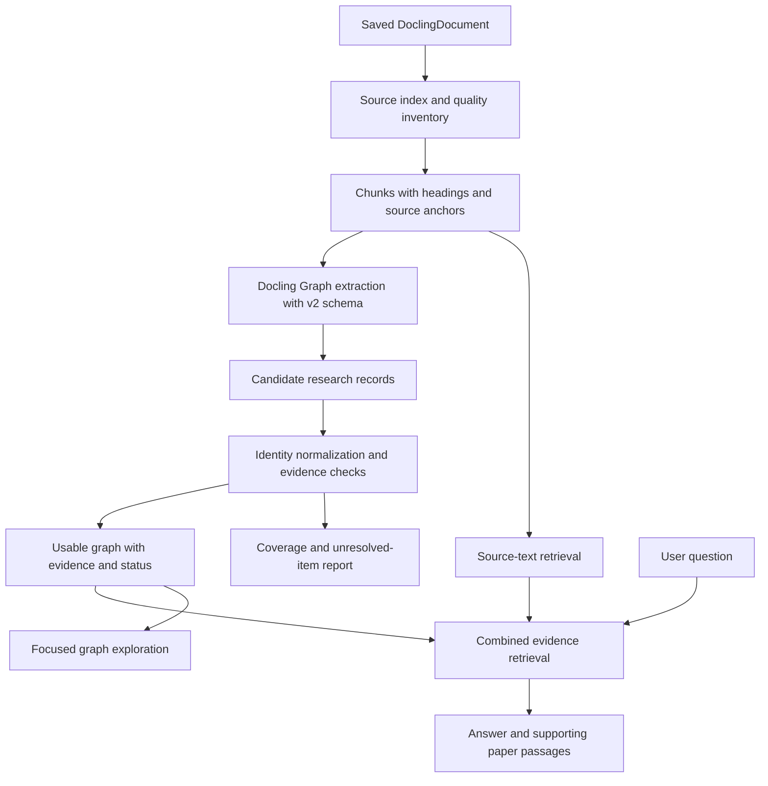

# Santio: from the current graph experiment to useful document intelligence

Status: proposed implementation plan; no v2 extraction or application integration has been implemented by this document.

Date: 16 October 2026. Scope: the isolated Docling Graph sandbox first, then Python/RAG integration after evaluation.

## 1. The outcome we want

A user supplies a technical research paper. Santio explains its contribution, method dependencies, training/evaluation setup, reported results and limitations, and answers questions with source evidence. A graph makes those relationships explorable; the original chunks preserve details that were not extracted into the graph.

Success means more useful, supported answers and faithful experimental context. There is no target node count, claim of perfect extraction, or assumption that an impressive visualization establishes correctness.

Initial v2 scope is technical research papers. We will use a reusable core schema with optional domain profiles, rather than pretend one enormous schema can describe every kind of document. Paper titles, dataset names and model names must come from input, not application logic.

## 2. What is implemented today

| Part | Current implementation | Practical limit |
|---|---|---|
| PDF extraction | Existing Docling pipeline and saved DoclingDocument JSON | Prose and many table cells are useful. The audited paper has merged cells in Table 2 and 14 detected formula regions with empty text. |
| Hierarchy | Saved heading levels and reading order; native Docling chunkers can derive heading breadcrumbs | The project's custom paragraph chunks omit breadcrumbs. Saved data does not contain a fully nested section tree. |
| Model connection | NVIDIA Nemotron 3 Super through Docling Graph/LiteLLM; live API test succeeded | A working connection establishes connectivity, not extraction quality. |
| Research schema | Small hand-written Pydantic template | Limited relationships, no dedicated contextual Measurement, no paper-level dataset collection, weak identity design. |
| Latest extraction | Direct contract over the whole heading-preserving Markdown, with a subsequent extraction/gleaning call | Chunking indexes provenance; this run did not extract separately from every chunk. |
| Graph | Native library graph plus JSON/CSV exports and standalone HTML viewer | The audited run has 93 nodes/210 edges, including duplicates, semantic errors and important omissions. |
| Evidence | Record quotations and native node provenance | 73 nodes have document-only provenance. There is no explicit per-edge provenance field in the current export. |
| RAG | Existing project chunk outputs can be reused | The sandbox does not yet implement retrieval/answers or connect the graph to the main frontend. |

Current files: `research_schema.py`, `sandbox.py`, `nvidia_client.py`, `viewer.py`. Preserve these as the reproducible v1 baseline before replacing defaults.

Baseline audit: [detailed report](outputs/2610.10539v1-20261016T054439275130Z/audit/REPORT.md). It documents 31 Concept/Metric duplicate pairs, 115 misclassified evaluation links, no Dataset nodes/training/evaluation edges, no limitation findings, and null structured values for all eight Findings. Numbers still exist in quotations; they are not absent from every artifact.

## 3. Research findings we will use

| Reference | Observed pattern | Planned application |
|---|---|---|
| [Docling Graph research template](https://github.com/docling-project/docling-graph/blob/main/docs/examples/templates/rheology_research.py) | Reusable experimental entities; inline quantities, units, ranges and contextual values | Model experiments and measurements explicitly; adapt the pattern to our domain rather than copy rheology-specific entities. |
| [Docling Graph dense extraction](https://docling-project.github.io/docling-graph/fundamentals/extraction-process/dense-extraction/) | Bounded identity discovery, merging and scoped detail extraction with coverage diagnostics | Compare direct and dense with the same v2 schema before selecting a default. Dense is a candidate, not a promised fix. |
| [Template tooling](https://docling-project.github.io/docling-graph/usage/cli/template-command/) | Template induction, linting and empirical diagnostics | Use generated proposals/lint reports to assist design, then inspect semantics and freeze a schema version. These diagnostics do not prove factual correctness. |
| [Neo4j KG Builder](https://neo4j.com/docs/neo4j-graphrag-python/current/user_guide_kg_builder.html) | Separate schema guidance, extraction, pruning and entity resolution | Use permitted source/relation/target patterns and an explicit normalization/quality stage. We do not need to adopt its database to use this architecture. |
| [Microsoft GraphRAG outputs](https://microsoft.github.io/graphrag/index/outputs/) | Relationships retain supporting text-unit identifiers | Store resolvable evidence for graph relationships and retain a route to original text. |
| [LightRAG SDK](https://github.com/HKUDS/LightRAG/blob/main/docs/ProgramingWithCore.md) and [paper](https://aclanthology.org/2025.findings-emnlp.568/) | Graph/text retrieval and hooks for candidate validation | Combine source chunks with graph context; distinguish source-name grounding from checking a relationship's meaning. |

These are documented mechanisms and design references. Published retrieval gains do not establish that their graphs are perfect or that a given approach will beat our baseline on our documents. Check installed-version support before relying on a newer documented feature.

## 4. The proposed pipeline



Docling remains responsible for document extraction. Docling Graph remains the model-backed structured-extraction and graph-conversion library. Our code supplies the research schema, source/evidence adapters, identity rules, quality checks, evaluation and retrieval integration. Native raw exports remain available alongside any normalized view.

## 5. What v2 will add

### A. A schema that represents the intended knowledge

Start with Paper, Method, Dataset, Concept, Experiment, MethodConfiguration, Metric, Measurement and Finding. A limitation is a typed Finding with conditions/caveats, rather than an unconnected summary string. A tool/model used as a component can initially be a Method with a component role; introduce another entity type only when it serves a question we actually need to answer.

Evidence anchors, units and simple conditions can be structured components attached to entities/relations. Every small value need not become a node.

Proposed relationship patterns include:

| Pattern | Example meaning |
|---|---|
| Paper INTRODUCES Method/Dataset | Distinguish this paper's contribution from prior work. |
| Paper DISCUSSES Method | Mentioned prior work does not automatically mean evaluated baseline. |
| Method BUILT_ON Method | A generative framework uses a particular backbone. |
| Method USES_COMPONENT Method | Depth estimation, segmentation or reasoning component. |
| Method USES_CONCEPT Concept | A genuine technical mechanism, not a metric copied into a concepts list. |
| Method TRAINED_ON Dataset | Training data belongs to the method/setup it trained. |
| Experiment EVALUATES MethodConfiguration | Preserve ablation/input settings and identify the underlying method. |
| Experiment EVALUATED_ON Dataset | Keep evaluation and training roles distinct. |
| Experiment REPORTS Measurement | The result belongs to a particular evaluation. |
| Measurement USES_METRIC Metric | Reuse the metric definition across datasets. |
| Paper/Experiment REPORTS Finding | Preserve source-reported claims, limitations and qualifications. |

Before implementing the full schema, prove that the installed Docling Graph reference/link patterns can express shared catalogs and these cross-links without recursive duplication. Use its public graph converter for that check. A proposed relationship becomes part of the schema only after that feasibility check.

The model may leave information unknown when genuinely absent. We will not force every paper to have non-empty dataset or limitation lists, because that can encourage invention. A separate source-coverage check will flag apparent omissions for investigation.

### B. Contextual measurements

A Measurement must retain:

- Experiment and dataset/split/task context, through explicit links or the experiment.
- Underlying method and configuration, including ablation/input conditions.
- Metric identity and direction, when stated.
- Exact reported value string; parsed numeric value only when unambiguous.
- Unit, displayed scale/multiplier, uncertainty/range when reported.
- Table identifier, row/column/header context, original cell text and source anchors.

Illustrative target for one existing paper result:

```text
Experiment: Toys4K comparison with estimated depth
Method/configuration: Tetris3D, estimated depth from MoGe3
Dataset: Toys4K
Metric: CD-S
Reported value: "7.56"
Reported multiplier: 100
Evidence: Table 4, PDF page 22, original Docling table cell
```

This does not assert a universal score for Tetris3D. Do not compare main and ablation results unless training and evaluation protocols make that comparison valid. Ambiguous merged cells stay unresolved instead of being split by guessed column positions.

### C. A source index and coverage report

Reuse the existing DoclingDocument and native structure-aware chunking. Retain heading breadcrumbs, reading order, item references, pages, bounding boxes where available, and table/caption references. Reuse existing paragraph chunks as a retrieval baseline, but enrich/rebuild their metadata from saved Docling structure for the proposed path.

Inventory Methods, Data/Training, Experiments, Results, Limitations and relevant appendix sections. Report for each region: supplied, attempted, completed, failed, yielded candidates or unresolved. A processed chunk with zero output is not automatically an error; record the difference between boilerplate and a suspected omission. A coverage percentage is a processing statistic, not a completeness/accuracy guarantee.

Treat quoted prompt examples inside a research paper as document content/protocol evidence, not runtime instructions.

### D. Identity normalization

- Reuse canonical metric definitions. Dataset-specific scores belong to Measurements.
- Resolve "ours" only within the paper and experiment where its meaning is supported.
- Link "Full model", "without V2I", and GT/VLM inputs to a MethodConfiguration; preserve their differences.
- Keep SAM3 segmentation and SAM-3D scene generation distinct.
- Use type-aware, document-scoped identities initially. Cross-paper merges require explicit identifiers/evidence and are a later feature.
- Record alias mappings and merge reasons. Do not merge entities solely because their strings look similar.

### E. Evidence and semantic quality checks

For candidate relationships, retain the supporting item/table-cell references, source excerpt, page and section context. Resolve every reference against the original input. Store evidence in a sidecar ledger where necessary; do not pretend native node provenance already provides relationship entailment.

Checks should distinguish:

1. Structural validity: expected types/fields and valid graph endpoints.
2. Source linkage: cited content actually exists; a quotation matches or is explicitly marked as a paraphrase.
3. Numerical assignment: the cited headers/cell support the method, metric and value together.
4. Semantic support: the source supports the relationship and its qualifications.

Deterministic checks can establish exact text/cell matches and type-pattern rules. A bounded model review can assist with entailment, but its judgment remains model-reviewed, not independent ground truth. Keep unsupported/unresolved candidates and reasons inspectable without adding them silently to accepted retrieval context. Human review can be optional; it is not the central product workflow.

### F. Observable and reproducible runs

Retain the existing versioned run directories and add schema/prompt versions, input and configuration hashes, request IDs where returned, model returned, finish reasons, retries/failures, timings and token usage. Show explicit fresh-run/cache-hit/partial/failed status. Cache identity must include input, schema, prompt, model and relevant settings.

Bound retries and preserve partial work. Expose actual extraction/merge/evaluation stages instead of a successful-looking graph after an incomplete run. Credentials never belong in the exported artifacts. This also makes it straightforward to distinguish a saved graph from a fresh API response.

## 6. Implementation sequence and completion gates

| Milestone | Work and deliverable | Gate before continuing |
|---|---|---|
| 0. Preserve and define | Keep both old runs/configurations and audit. Convert the audit checklist into a versioned development reference with explicit matching rules; freeze it before v2 extraction. | Reference includes source support and represented/attribute-only/missing distinctions; no claim of independent gold labels. |
| 1. Schema feasibility | Draft `research_schema_v2.py`; prove shared identities and method/dataset/measurement links with a small source-backed example; run native lint/conversion checks. | Actual converter produces the intended types and relationships; metrics do not become architectural concepts; configurations remain distinct. |
| 2. Evidence adapter | Build a source index from saved JSON and enrich chunks with native heading context. Inventory unreadable formulas/merged cells. | Evidence references resolve; missing upstream content is reported rather than invented. |
| 3. Extract and assess | First run v2 direct with the same source/model/format/generation settings as v1 where possible. Add normalization, source checks and quality reports. | Development cases recover named datasets/baselines, supported dependencies, limitations and unambiguous measurements; known false links are rejected. |
| 4. Controlled mode comparison | With v2 fixed, compare direct with dense/scoped extraction. Keep input, schema, serialization, model and reasoning settings fixed; report request/token/runtime differences. | Select by coverage, support and numerical assignment, with cost/latency shown. More calls or more nodes alone do not establish improvement. |
| 5. Generalization | Run a second paper not used to tune the schema; expand to the remaining user-provided papers. Keep failures/unsupported domains explicit. | No paper-specific names or table positions in extraction logic; measure performance separately per paper. |
| 6. Combined retrieval | Add a Python interface that retrieves source chunks and relevant graph neighborhoods, returning a common evidence bundle. Generate answers from that bundle. | Compare with the existing chunk-retrieval baseline on the same questions; identify the retrieval method honestly (lexical/vector/hybrid). Any new embeddings/provider are configured explicitly. |
| 7. Demonstration and integration | Use the proven pipeline in the app: answer/summary, focused graph, contextual result cards, PDF-linked evidence. | Main workflows work on user-selected input; partial failures are visible; changes are integrated only after the sandbox gates pass. |

Dense extraction already produced a poor earlier run. Do not repeat that run and declare the mode fixed. The controlled comparisons distinguish a schema improvement from a processing-mode change. Compare practical token budgets/latency transparently; different contracts naturally make different numbers of calls.

Any separate Methods/Results/Limitations passes should be introduced only if native dense/coverage behavior leaves a demonstrable gap. Use the same schema and source anchors, bound the calls, merge through supported mechanisms, and label that as another experiment rather than changing several variables silently.

## 7. How improvement will be measured

Separate development regression checks from a held-out paper/question set. The existing 51-item checklist was constructed retrospectively and is useful for development; it is not an unbiased benchmark.

| Measure | What we will report |
|---|---|
| Entity coverage | Correctly represented reference entities by type; do not reward aliases/duplicates. |
| Relationship quality | Supported, misclassified, unsupported, unresolved and missing links under explicit acceptance rules. |
| Numerical correctness | Correct method/configuration-dataset-metric-value assignments among evaluated cells, plus coverage and abstentions. |
| Qualification retention | Whether conditions, exceptions, negation and limitations survive. |
| Source traceability | Resolvable references and appropriate relationship/table evidence; separate this from entailment. |
| Retrieval/answer quality | Whether the necessary evidence is retrieved and the answer uses it correctly, including abstention on absent information. |
| Operational behavior | Calls, tokens, elapsed time, failures, retries, cache reuse and unfinished regions. |

No arbitrary "95% accurate" target. The first gates are concrete: all known regression false links fail acceptance; all accepted unambiguous regression measurements match source cells; every exposed accepted item has resolvable source support. These statements apply to the checked cases, not every possible fact in the document. Broader quality remains measured, not assumed.

Initial question categories: contribution; method dependencies; training versus evaluation datasets; compared baselines; full versus ablation configuration; a particular table value; estimated-depth exceptions; GT versus VLM inputs; inference components; limitations and propagated errors; protocol differences; an unreported detail requiring abstention.

## 8. The demonstration and product outputs

The primary experience remains intelligence: "Explain this paper", "What supports this claim?", "Why is this configuration different?", and "What are the limitations?" Inspection is a supporting explanation/debugging view.

New outputs will include normalized research records, measurements, relationship evidence, alias mappings, coverage/quality reports, an evidence bundle for RAG, and a paper understanding view generated from supported records/source passages. Graph JSON/CSV and raw native outputs stay exportable.

Graph exploration should open with a method/experiment neighborhood, display meaningful relationship labels, show measurement conditions and direct PDF links, and distinguish source-linked/model-reviewed/unresolved states. Full-graph browsing remains available without making a dense diagram the only way to understand the paper.

Python/RAG integration returns plain, versioned data structures so other systems can consume chunks, graph context and citations without adopting our viewer or a particular graph database. Neo4j/LangChain-specific adapters can follow a stable core; they are not prerequisites for this sandbox.

## 9. Later additions, after the text/measurement baseline works

- Selective table recovery for demonstrably merged headers/cells, with before/after evidence and original extraction preserved.
- Formula recognition and diagram interpretation for regions whose semantics matter to a question. This may need a vision-capable model/provider; the current text-only Nemotron request cannot inspect figure pixels.
- Cross-paper method/dataset identity resolution, protocol-aware comparisons and conflicting-claim handling.
- Larger-scale persistence, deployment and access controls when application integration justifies them.

These are staged extensions, not features silently claimed as implemented. Continue reusing Docling and library capabilities before adding custom recovery code.

## 10. Immediate next work

Freeze the development reference and schema requirements, then implement/prove the minimal v2 relationship and measurement model. Only after that proof should we spend another full-paper extraction run. The first reviewable result should be a small, source-supported experiment graph with one contextual measurement, method dependency, dataset relationship and limitation, accompanied by its quality report.
