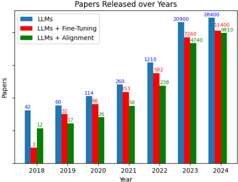

# Granite Vision GPU test

## Result

Granite Vision 3.3 2B runs locally on the RTX 3050 6 GB using 4-bit language weights and bfloat16 computation. This proves local inference is feasible, not that captions are accurate. Keeping the vision layers at full precision improved numeric reading on this sample. One false comparative statement remains, so the converter was not switched to Granite.

## Input and evaluation scope

The input was the same 484 x 371 pixel chart crop from PDF page 1 used in the earlier SmolVLM test. No PDF was reconverted. A small AI-prepared reference was recorded before Granite inference and was not supplied to the model. This is one-image exploratory testing, not a benchmark or independently verified accuracy score.



[Reference](chart_reference.json)

## Actual runs

| Run | Load seconds | Generate seconds | Tokens | Peak GPU allocated GiB | Assessment |
|---|---:|---:|---:|---:|---|
| [Float16 setup](granite-probe-4bit/results.json) | 18.24 | — | — | — | Failed before generation because the diagnostic read an unavailable reporting attribute. The diagnostic was fixed. |
| [Float16 generation](granite-probe-4bit-retry/results.json) | 17.1 | 3.9 | 1 | 2.848 | Generated only a stop token; empty decoded answer. The old report says completed, but this is not usable output. The script now rejects empty answers. |
| [Bfloat16 generic prompt](granite-probe-4bit-bfloat16/results.json) | 11.88 | 4.73 | 13 | 2.848 | Nonempty, accurate broad sentence about paper counts; missing year range, legend, colors and trend. |
| [Bfloat16 detailed prompt](granite-probe-chart-details/results.json) | 16.38 | 29.53 | 200 | 2.879 | Correct year range, axis meanings, legend categories and colors. Reached the 200-token cap; the growth claim is supported by the enlarged source chart. |
| [Bfloat16 concise prompt](granite-probe-chart-concise/results.json) | 14.23 | 15.06 | 192 | 2.911 | Finished without hitting the cap, but ignored requests to avoid per-year numbers and misread values. |
| [Unverified vision exclusion](granite-probe-chart-full-vision/results.json) | 15.84 | 29.65 | 192 | 2.911 | The exclusion patterns did not match nested vision modules. Footprint and output matched the previous run. Do not count this as a full-precision vision comparison. |
| [Verified full-precision vision](granite-probe-chart-verified-full-vision/results.json) | 16.4 | 26.15 | 191 | 3.51 | Zero quantized vision/projector layers verified. Correct year range, categories and all three 2024 values. One wrong category comparison remains; see source checks. |

## Last verified configuration

- Cached IBM model revision is recorded in each raw report.
- Bitsandbytes 0.50.2 was added to the existing environment. Dependency checks passed.
- 4-bit NF4 language-layer weights, double quantization, bfloat16 computation.
- Vision tower and multimodal projector retained at bfloat16 precision; the diagnostic asserts that no such layer is quantized.
- All model parameters were on CUDA; no CPU offloading was used.
- Model footprint about 2.14 GiB; inference peak allocated about 3.51 GiB.
- 200-token cap and 120-second generation time budget.

## Last model answer (unverified model output)

> The chart shows the number of papers released over a seven-year period from 2018 to 2024, categorized by three types of research: LLMs, LLMs + Fine-Tuning, and LLMs + Alignment. The LLMs category consistently has the highest number of papers released each year, with a peak of 28,400 in 2024. The LLMs + Fine-Tuning category shows a steady increase in the number of papers released, reaching 11,400 in 2024. The LLMs + Alignment category starts with the lowest number of papers released in 2018, but shows a significant increase, reaching 9,810 in 2024. Overall, the chart indicates a growing trend in the release of papers in all three categories over the seven-year period.

## Source checks

- Correct: visible year range 2018–2024 and the three legend category names.
- Correct: the three 2024 values are 28,400 (LLMs), 11,400 (Fine-Tuning) and 9,810 (Alignment), matching the enlarged input crop.
- Incorrect: the answer says Alignment has the fewest papers in 2018; the red Fine-Tuning bar is smaller.
- The answer ignores the instruction to avoid per-year numeric values, omits requested colors and exceeds the requested 90 words. Those are instruction-following limitations, separate from factual correctness.
- The detailed prompt recovered axis/legend/color information, but changed prompting means this is not a model-only controlled comparison against SmolVLM.
- Generic SmolVLM CPU timings and Granite GPU timings are not an apples-to-apples speed benchmark.

## What changed

Only sandbox diagnostics and the added quantization dependency changed in this test. The original frontend/backend and saved extraction documents were not edited. The sandbox converter retains the previously applied 2% formula crop setting and still uses SmolVLM for descriptions. No new chunking, embeddings, or RAG integration was implemented here.

## Next checkpoint

Use this as a GPU feasibility result and a promising sample for selective quantization. The final answer still contains one false comparative claim and needs review. More representative image evaluation is needed before adopting picture descriptions. Text and tables can proceed to the separately reviewed chunking stage.

## Reproduce the verified configuration

From C:\Santio, in PowerShell:

```powershell
.\.venv\Scripts\python.exe .\playground\vector-rag\diagnostics\granite_vision_probe.py .\playground\vector-rag\diagnostics\enrichment-review\picture-probe\crop-1.png --output .\playground\vector-rag\diagnostics\enrichment-review\granite-manual-test --keep-vision-full-precision --prompt "Summarize this chart in at most 90 words. State the axis meanings, visible year range, legend categories and colors, then give only the overall trend. Avoid per-year numeric values. Do not claim that every series increases every year unless clearly visible. If a label is unreadable, say so."
```

Choose a new output directory if granite-manual-test already exists. Inference uses the downloaded model locally and does not require an API key.

## Review correction

An earlier manual reading of the small chart preview misread the 2024 values and suggested an unsupported year-on-year growth criticism. Review of the enlarged 484 x 371 crop corrected both judgments. The source checks above and comparison JSON reflect the corrected reading. Raw model results are unchanged.
