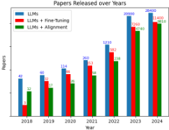
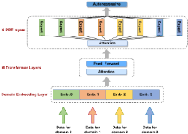
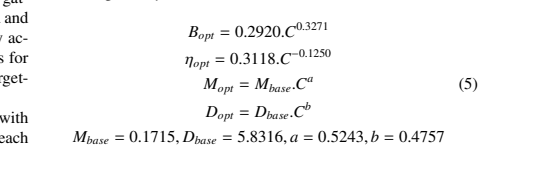
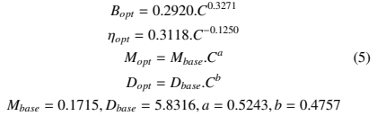

# Enrichment review

Reviewed on 16 October 2026. Source: `C:\Santio\2307.06435v10.pdf`.

## Conclusion

The conversion completed, but the optional model-generated enrichments have
demonstrable quality problems. Warning suppression would not resolve those
problems. A tighter formula crop improved one failing example; increasing picture
resolution did not make the tested chart description reliable.

This review does not establish accuracy for every page or equation. The converter,
its two saved conversion runs, dependencies and original application were not
modified during this investigation. Only diagnostics were added.

## Saved-output comparison

Compared the initial run ending `143319043497Z` with the enriched run ending
`144018745283Z` in the sandbox outputs directory:

- Both contain 47 pages, 1,066 text items, 15 tables and 14 pictures.
- All 15 tables have identical `data` fields across the two runs. This is a
  consistency check, not a validation of the table values against the PDF.
- Only the six formula items have changed text. Original backend text is also
  retained in their `orig` fields.
- Eleven pictures have nonempty descriptions. The other three occupy about
  4.11%, 3.58% and 3.96% of their pages, below the default 5% description threshold.
  Their absence is explained by filtering, not evidence of an inference failure.
- Four descriptions re-encode to exactly the default 200-token limit. Some end
  mid-sentence. Native picture probes also returned exactly 200 generated tokens.

Full comparison data: [audit.json](audit.json).

## Source-checked content problems

### Figure on page 1

The chart covers 2018 through 2024, with categories LLMs, LLMs + Fine-Tuning and
LLMs + Alignment. The original generated description instead states that there
are four years from 2018 through 2021 and misidentifies categories and colors.

### Figure on page 16

The source is an architecture diagram, including transformer layers and domain
embeddings. Its generated description calls it a table and invents headers such
as "H PFE UPS" and "Asistance". This is a substantive content failure.

### Formulas

- Page 9, `#/texts/234`: enrichment duplicates the equation and introduces LaTeX
  alignment/intertext fragments.
- Page 10, `#/texts/264`: enrichment leaves only `\begin{array} {`, while the PDF
  contains five lines of scaling equations and constants. The original text is
  still available in `orig`.

## Bounded, offline formula experiment

Used the installed Docling inference engine and cached CodeFormulaV2 model on
individual PDF crops. Each call had a 256-token output cap and 45-second
generation time budget. All probe cases used CPU, float32 and four threads.
These settings differ from the original full-run batching/precision, so the
probe is not a complete reproduction of the original run.

Within the probe, crop margin was the only changed setting between the two
page-10 cases:

| Case | Result |
|---|---|
| Simple ReLU, default 18% margin | Correct-looking transcription; 31 generated tokens, 8.92 seconds. |
| Page-10 block, 18% margin | Repeated `c` tokens in an unfinished array declaration; reached 256 tokens in 30.16 seconds. |
| Same block, 2% margin | Transcribed all five equation lines and constants; 209 tokens in 27.07 seconds. |

The default crop visibly includes neighboring-column text. The tighter crop
removes it:

This supports a crop-context problem for this example. It does not establish
that a global 2% margin is best for all formulas. The tighter output is a
transcription candidate, not a standalone compiled LaTeX artifact.

Raw results: [formula probe](formula-probe/results.json).

## Bounded, offline picture experiment

Used the cached SmolVLM-256M model through Docling, one chart per call, with the
same default description prompt, CPU/float32/four threads, a 200-token cap and
45-second generation time budget. Only rendering scale differed:

| Crop | Result |
|---|---|
| 242 x 186 pixels, scale 1 | Incorrect year/color interpretation; unfinished description; 200 tokens, 37.95 seconds. |
| 484 x 371 pixels, scale 2 | Counts incorrectly called percentages; LLMs expanded as "Longitudinal Study"; repetitive bullets; 200 tokens, 37.21 seconds. |

Higher resolution alone did not solve reliability on this chart. A stronger
model should be evaluated on a small representative sample before substituting
it globally. Increasing the token cap alone does not fix invented content.

Raw results: [picture probe](picture-probe/results.json).

## Interpretation of warnings and runtime

- Symlink caching: storage-efficiency warning, not evidence of extraction damage.
- Unauthenticated Hub requests: download limits; public models still loaded.
- Download timeout: resumed successfully in the supplied log.
- Padding warning: reproduced while loading model configurations. SmolVLM's
  effective top-level configuration reports 128002, but its text vocabulary has
  49280 entries. Its tokenizer and saved generation configuration use valid
  padding token 2; the installed Docling engine explicitly uses tokenizer padding
  when constructing generation settings. The warning alone does not prove that
  an invalid padding token was used during generation.
- Tied weights: CodeFormulaV2's cached top-level config requests tied weights,
  while its nested text configuration says false. Transformers warns that it is
  retaining different checkpoint weights separately. The warning appeared during
  both successful and unsuccessful formula samples. No configuration was changed
  merely to hide it.
- PyTorch reports no available CUDA device in this environment. This supports CPU
  inference as a runtime concern. The original 58-minute duration also includes
  downloads/initialization; there is no per-stage timing to assign its exact cause.

## Recommended next checkpoint

1. Preserve raw extraction separately from candidate formula enrichment. Flag
   malformed/repetitive candidates before using them downstream.
2. Test tighter formula margins on several different equations, not only the
   successful page-10 example.
3. Compare a stronger vision model on the chart and architecture diagram. Keep
   generated descriptions labeled as model output with source references.
4. Extend reporting with actual description coverage and quality flags rather
   than treating enabled settings or conversion success as accuracy checks.
5. Continue the text/table chunking checkpoint independently; do not silently
   promote these unreviewed descriptions into trusted RAG evidence.

Reproducible probes: `../check_enrichment.py --help`. They require an existing
Docling JSON, original PDF and a new output directory; they do not reconvert the
PDF or make NVIDIA API calls.
